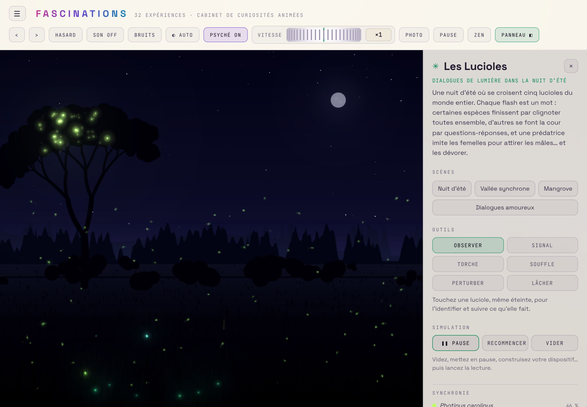
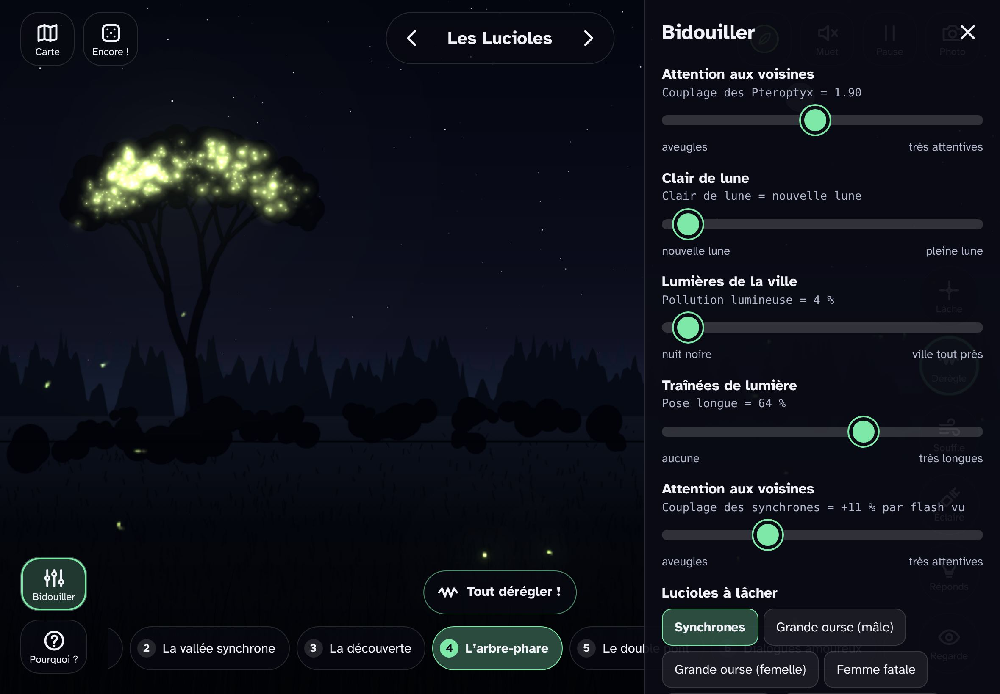
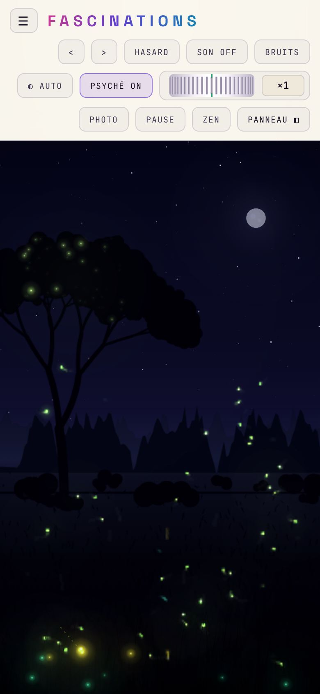
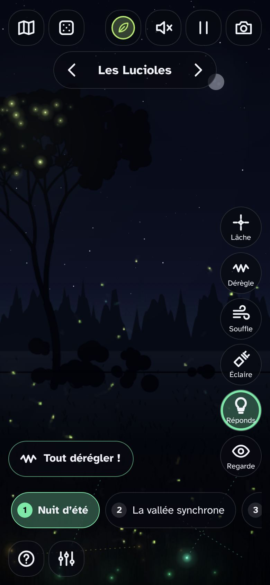
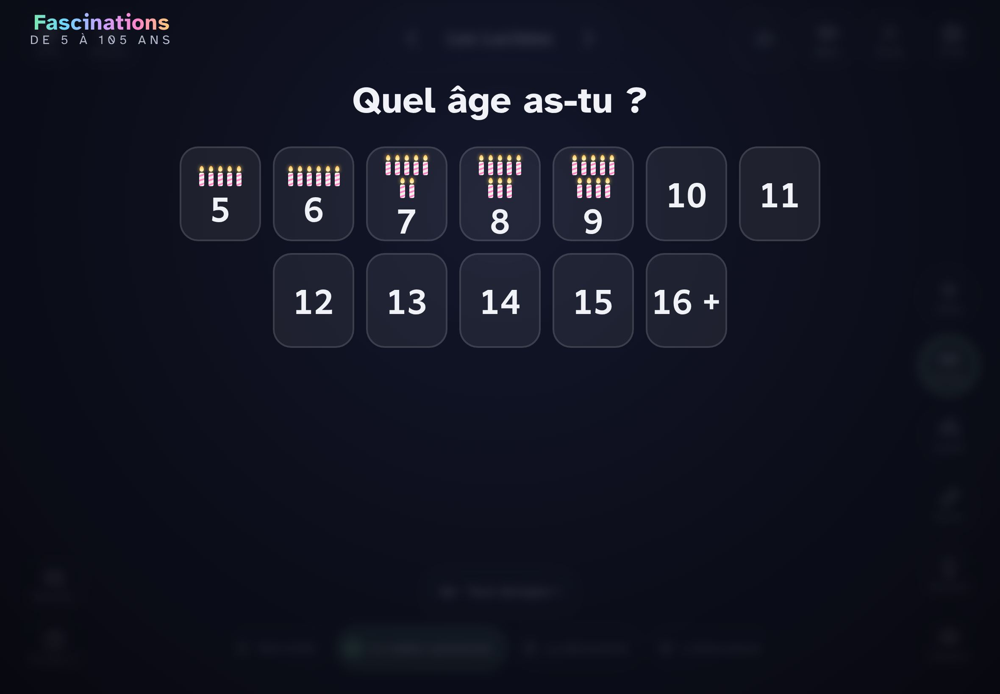
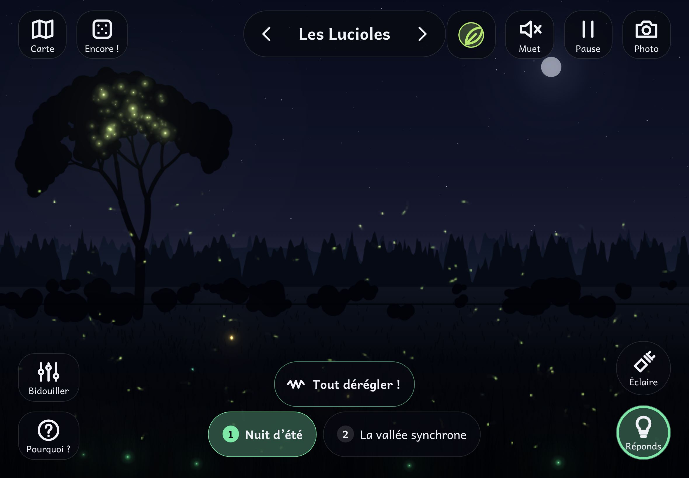

# Pour Yoann : une seule application Fascinations (branche `app-unique`)

C'est ta « carte blanche » de la nuit, appliquée jusqu'au bout. **La version adulte et Fascinations Labo ne font plus qu'une seule application.** Personne n'est rangé « chez les petits » : à la première ouverture, on dit son âge, puis son niveau, et l'interface s'adapte. L'ancienne version adulte devient le niveau **« Je connais déjà »**.

**Rien n'est sur `main`.** Cette branche part de `jeunesse`, et `jeunesse` garde la version d'avant la fusion. Tout est réversible. Avant `main`, il faut la recette de Constance (avec le regard d'un enfant de 5 ans).

## Ce qui change pour toi
- **À l'ouverture** : « Quel âge as-tu ? » (des bougies sur les chiffres pour les petits), puis un signe (un avatar), puis le niveau (dès 9 ans). Pour toi : **16 +**, puis **Je connais déjà**.
- **On n'arrive plus sur une machine, mais sur une question** (« Comment les insectes se parlent-ils ? »). Chaque question est un **chemin de chapitres**, en bas de l'écran, qui peut traverser plusieurs machines. Il y a 24 questions dans 6 mondes, à la place des 32 machines en liste.
- **L'écran est la machine en entier** : quelques boutons ronds dans les coins, et plus de bandeau en haut ni de panneau fixe à droite.
- **Les réglages** : le bouton Bidouiller (en bas à gauche) ouvre les réglages parlants et les recettes. Au niveau « Je connais déjà », il ouvre aussi :
  - la vitesse fine ;
  - le décor ;
  - le fond clair ;
  - « Vider » ;
  - **le Labo**, avec tous les vrais réglages de la machine, sous leur vrai nom et avec leur vraie valeur.
- **« Pourquoi ? »** : un fil qui se déroule (une phrase, puis « encore »), et le texte adulte complet dans « Pour les curieux ».
- **Les raccourcis clavier** sont gardés :
  - ← → : naviguer ;
  - espace : pause ;
  - S : son ;
  - R : hasard ;
  - Z : spectacle (l'ancien mode Zen) ;
  - P : photo ;
  - C : carte.

## Ce qui disparaît
- **Le filtre « Psyché »** : il décalait les teintes en continu. C'est contraire au principe adopté cette nuit pour le rendu : « plus beau, jamais faux ».
- **La liste des machines à gauche** : remplacée par la carte des questions (C ou le bouton Carte).
- **La molette de vitesse** : remplacée par un curseur de vitesse fine, dans Bidouiller, au niveau 3 ou plus.
- **Provisoirement, le générateur de bruits** (blanc, rose, brun…). Son interface dépend de l'ancienne mise en page ; il reste dans le code (`app/js/bruits.js`) et il est à reporter.
- **Le thème clair de l'interface** : le choix « fond clair » existe pour les machines, mais les boutons restent sombres.
- **La seconde application** : un seul fichier (`dist/fascination.html`), une seule APK à terme. L'APK n'est pas reconstruite cette nuit : la nouvelle clé de signature passe par le workflow, avec ton approbation.

## Avant / après (captures, en rendu logiciel)
| Avant (version adulte) | Après (application unique) |
|---|---|
|  |  |
|  |  |
| |  |
| |  |

D'autres captures (carte, fil, téléphone) sont dans `docs/captures-jeunesse/nav-*.jpg`.

## Pour l'essayer
- **Sur ordinateur** : ouvrir `dist/fascination.html`. Pour revoir l'accueil, vider le stockage du site ou passer par le coin des grands (appui long sur le logo de la carte).
- **L'ancienne version**, pour comparer : `node tools/build.mjs ancienne`, qui produit `dist/ancienne-adulte.html`.

## Ce qui reste à faire, et que je sais
- **Pas de test sur une vraie tablette, ni avec le son.**
- **La pause des 2 derniers chapitres sans les détruire** : aujourd'hui, un chapitre quitté garde ses réglages, mais pas ce qui y a été construit.
- **Le générateur de bruits** est à reporter.
- **Le chantier du rendu continue en parallèle** (branches `rendu-a` et `rendu-b`). Il viendra se poser sur cette base une fois relu.
